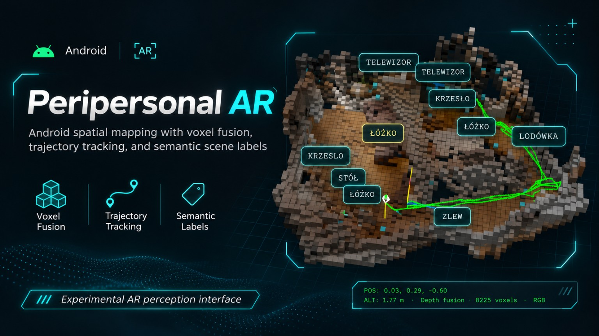
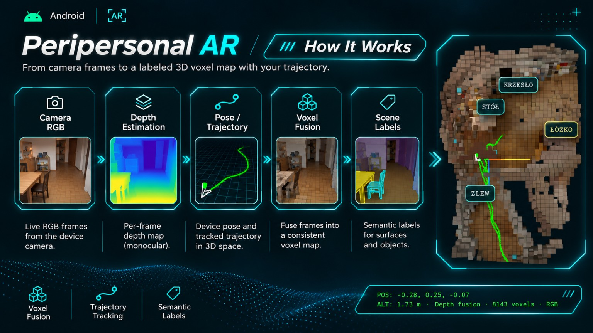

# Peripersonal AR



**3D spatial mapping and scene visualization for Android.**

Peripersonal AR is an experimental Android application created by **Tomasz Wietrzykowski**. It explores how a mobile device can represent an indoor environment as a 3D scene, display a movement path through that scene, and show labels associated with objects in the surrounding space.

The current prototype displays a colored voxel map, a green trajectory, object labels, and live-looking position and mapping readouts. The project is shared as an installable APK for testing and demonstration.

**Status:** Experimental prototype  
**Platform:** Android  
**Download:** GitHub Releases  
**Distribution:** APK only. Source code is not included.

## What you can see

The demonstration shows an indoor space represented by small colored 3D blocks, or voxels. The view contains recognizable floor areas, walls, furniture, and passages. A green line runs through the reconstructed scene, with labels placed near objects.

Two views captured from the application show the map from different perspectives. The status line reports more than 8,000 voxels in those examples.

### Visible features

| Feature | Shown in the current prototype |
| --- | --- |
| 3D voxel map | Colored blocks forming an indoor scene |
| Depth fusion | `Depth fusion` appears in the status line |
| Movement trajectory | A green path drawn through the mapped space |
| Scene labels | Names positioned near recognizable objects |
| Position readout | Three coordinates shown after `POS` |
| Height readout | A value in meters shown after `ALT` |
| Voxel count | A numerical count in the status line |
| RGB mode | `RGB` appears in the status line |

### Object labels in the demonstration

The current screenshots show Polish labels for objects in the scene:

| Label | English |
| --- | --- |
| `TELEWIZOR` | Television |
| `KRZESŁO` | Chair |
| `ŁÓŻKO` | Bed |
| `STÓŁ` | Table |
| `LODÓWKA` | Refrigerator |
| `ZLEW` | Sink |

The screenshots establish that these labels appear in the interface. They do not establish which recognition model, if any, generates them or how their positions are computed.

## Example status readouts

One screenshot shows:

```text
POS: 0.03, 0.29, -0.60
ALT: 1.77 m
Depth fusion · 8225 voxels · RGB
```

Another shows:

```text
POS: -0.28, 0.25, -0.07
ALT: 1.73 m
Depth fusion · 8143 voxels · RGB
```

These are examples from the application screen, not benchmark results or validated distance measurements.

## How the idea fits together



*Illustrative concept diagram. It is not a verified description of the application's internal processing pipeline. In particular, the image's reference to monocular depth estimation has not been confirmed from source code.*

The project combines three kinds of visible information:

1. **Geometry:** a 3D voxel representation of the surrounding space.
2. **Movement:** a trajectory displayed inside the map.
3. **Context:** text labels associated with objects in the scene.

The exact algorithms for depth estimation, position tracking, voxel fusion, and labeling are not documented in this binary-only release. This README intentionally does not attribute the implementation to a particular SLAM library, framework, or machine learning model.

## Download and install

1. Open **Releases** on this repository page.
2. Open the latest release.
3. Under **Assets**, download the `.apk` file. Choose the APK, not GitHub's automatically generated **Source code** archives.
4. Open the APK on your Android device.
5. Review the Android installation prompt. If you trust this release, allow installation from that source when prompted.
6. Open Peripersonal AR and review any permissions requested by the application.

This is an experimental build. Android version requirements, supported devices, performance, and stability have not been verified across a broad range of phones.

## Project background

The name comes from *peripersonal space*, a neuroscience term for the region near the body that is important for perception and action.

Peripersonal AR uses the term as inspiration for a software experiment about spatial representation around an observer. It does not claim to reproduce the biological mechanisms of peripersonal perception.

The work relates to spatial computing, augmented reality, computer vision, 3D reconstruction, and robotics.

## Current limitations

The screenshots and available project information do not confirm:

- The depth estimation model or algorithm.
- Whether a specific SLAM, visual odometry, or AR framework is used.
- The coordinate system, calibration, or metric accuracy.
- How the map is updated and how object labels are generated.
- Whether processing is fully offline.
- Minimum Android version, device compatibility, or performance targets.

The visualization is not a certified measurement or navigation tool. Do not rely on it for safety-critical navigation, obstacle avoidance, or precise measurements.

Indoor maps and screenshots may reveal private information. Please consider this before sharing them publicly.

## Feedback

If you test the APK, feedback is welcome through GitHub Issues. Useful details include your device model, Android version, what you tried, what happened, and any error message. Please do not include private location or household information in issue reports.

## Distribution

This repository provides documentation, project images, and an Android APK through GitHub Releases. It does not contain the application source code. No open-source license or permission to modify and redistribute the APK is implied by its public availability.

## Author

**Tomasz Wietrzykowski**  
Independent project: **Peripersonal AR**

---

*An experiment in representing nearby physical space through 3D geometry, movement, and scene annotations.*
